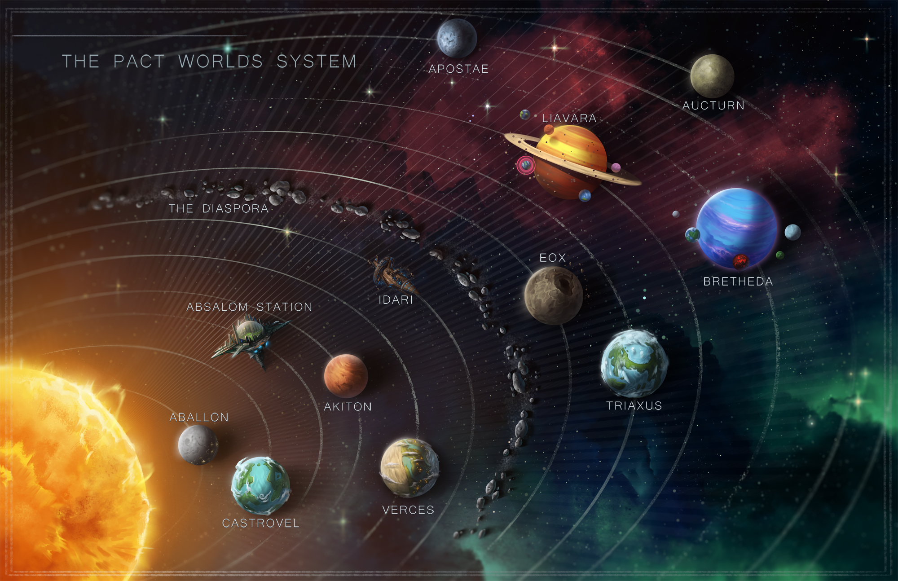

# Galaxy

The main regions of the sector your character knows. For who runs them, see [Factions](factions.md).

!!! note "Canon vs. homebrew"
    Each region is tagged. **Canon** places are in the Starfinder 2e books. **Campaign** places are made up for this game. The details your GM hasn't shown you yet are deliberately left blank.

## Map

<figure markdown>
{ loading=lazy }
<figcaption markdown>
**The Pact Worlds system.** This map shows only the home system. The map of the whole galaxy, *Desna's Path*, is a poster in the [*Starfinder Galaxy Guide*](https://store.paizo.com/starfinder-2e-galaxy-guide/). The newer Pact members (Dykon, Kalo-Mahoi, Marata, Pulonis) and the campaign regions such as Federation space and the Wall are not on it. 
Map © Paizo Inc., from the Starfinder [Community Use Package](https://paizo.com/licenses/communityuse/package). See [License](../license.md).
</figcaption>
</figure>

## At a glance

| Region | Who's there | Tag |
|---|---|---|
| [The Pact Worlds](#the-pact-worlds) | Pact Worlds | Canon |
| [Near Space](#near-space) | Veskarium, Marixah Republic, Gideron Authority | Canon |
| [The Azlanti Star Empire](#the-azlanti-star-empire) | Azlanti | Canon |
| [The Vast](#the-vast) | Frontier settlements, and the Swarm | Canon |
| [The Scoured Stars](#the-scoured-stars) | Starfinder Society expeditions, and something old | Canon |
| [The Drift](#the-drift) | Anyone with a working engine | Canon |
| [Federation space](#federation-space) | The Federation | Campaign |
| [The Wall](#the-wall) | The Federation fleet, and the Swarm | Campaign |
| [Krethiskar](#krethiskar) | The Swarm subcolony | Campaign |

## Canon regions

### The Pact Worlds

The home system. **Absalom Station** is the capital and the center of everything since the Gap, when Golarion vanished. The worlds around it include **Castrovel, Verces, Eox, Akiton** and **Aucturn**, plus the **Idari** colony ship. The Drift Crisis added **Dykon, Kalo-Mahoi, Marata and the Diaspora**, and **Pulonis** has just joined.

*Mood:* Crowded and restless. It's rich, diverse and frightened, because the Swarm is coming.

### Near Space

The crowded region around the Pact Worlds, claimed by several powers. The **Veskarium** is the biggest, a vesk empire built on conquest. The **Marixah Republic** and the **Gideron Authority** are its smaller neighbors, in a territorial dispute since 302 AG that turned into an annexation when **Acalata** fell in 318 AG.

*Mood:* Tense. Borders matter and they keep moving.

### The Azlanti Star Empire

A human empire that sits beyond the Veskarium. The two have been at war since the **Battle for Kehtaria** in 324 AG. The empire's own leadership is broken, after the assassination of **Imperator Iorian** and the exile of **Imperator Yridela**.

*Mood:* Proud, wounded and unpredictable.

### The Vast

The wild frontier beyond Near Space. It has few laws and fewer maps, which is why the **Swarm** was able to hit **Suskillon** there before anyone could organize against it. It's where the shirren species escaped the hive mind in 83 AG.

*Mood:* Lawless and distant. Help is a long way off.

### The Scoured Stars

A region of old, strange places. Starfinder Society explorers caused the **Scoured Stars incident** here in 317 AG, and a dormant deity, **Kadrical**, woke in 319 AG.

*Mood:* Unsettled. Something is awake out there.

### The Drift

Not a place on a map, but the other dimension that ships cross to travel faster than light, found after **Triune's Signal** in 3 AG. It **crashed** in 321 AG and stranded fleets where they stood. It's working again, and nobody trusts it entirely.

In this campaign, [Drift Engines work a little differently](homebrew.md#drift-engines).

*Mood:* Fast, strange and a little scary.

## Campaign regions

### Federation space

The territory the **Federation** has colonized, and it's the sector's best-organized military power. Its colonies are branded, contracted and heavily policed. Convicts and debtors are sent here to work off their sentences, in "reformatory cities" like the moon you started on.

*Mood:* Orderly on the surface, and not on the other side of it.

### The Wall

The line between the Federation and the Swarm. Federation broadcasts say **the Wall holds**. Refugees say it's falling back, and they have no reason to lie.

*Mood:* Two stories, and one of them is wrong.

## Your character's home

Pick where your character comes from. It doesn't have to be one of these, but it should be a place the GM can actually use. Bring it to the [Pre-Campaign Meeting](pre-campaign-meeting.md).
